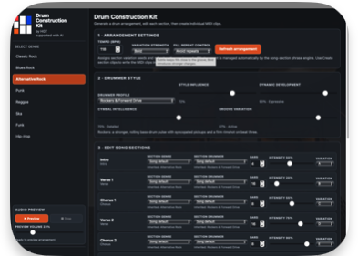
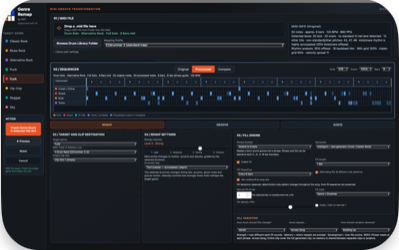
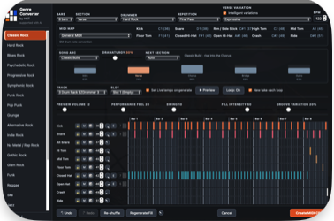

# HGT – Ableton Extensions

### Creative Tools for Ableton Live

**Three extensions. More creative possibilities. One vision for music.**

Independent tools for creative music production with Ableton Live.

**Developed by HGT · Supported with AI**

---

## Our Extensions

### 01 · Drum Construction Kit

**Build your drum arrangements. Shape your drummer. Create your sound.**

Create complete drum arrangements with genre-specific grooves, drummer profiles, fills, variations and individual song sections.

[View Project & Downloads – Drum Construction Kit](https://github.com/hgtroester-ai/drum-construction-kit)

---

### 02 · Genre Remap

**Transform your grooves. Explore new musical directions.**

Transform existing MIDI drum patterns into different musical styles with adjustable groove, variation and performance settings.

[View Project & Downloads – Genre Remap](#)

---

### 03 · Genre Converter

**One groove. Different genres. New possibilities.**

Create genre-specific drum grooves, variations, fills and complete musical arrangements.

[View Project & Downloads – Genre Converter](#)

---

## Compatibility & Technology

- Requires Ableton Live 12.4.5 or later.
- Built with the Ableton Live JavaScript SDK.
- Currently testing with Ableton Live 13 Beta.

---

## Downloads & Releases

Each extension has its own project page and release history.

Available downloads:

- Ready-to-install Ableton Extension (`.ablx`)
- Complete source code (`.zip`)
- Version information and release notes
- Installation instructions

---

## About HGT

**The only good system is a sound system.**

**Music connects people.**

Independent development and creative tools shared with the music community.

Free to use. Community supported.
